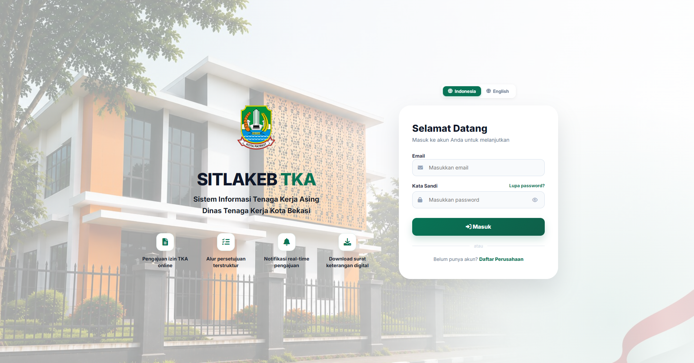
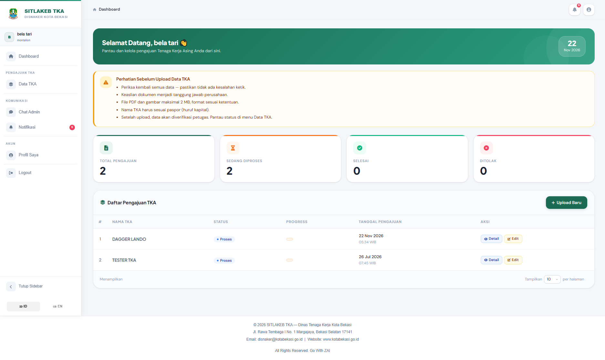
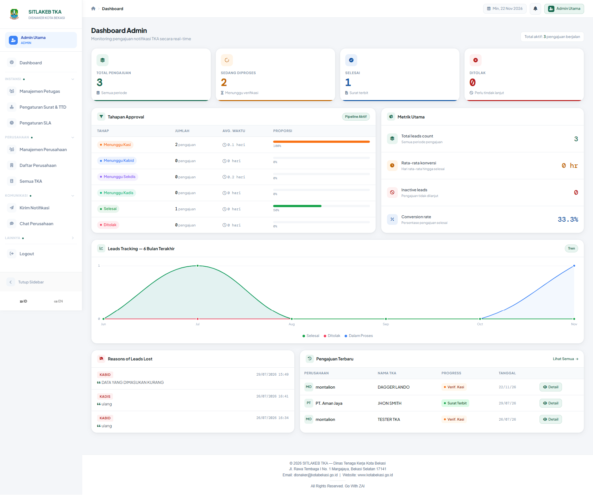

SITLAKEB TKA
============

**Sistem Informasi Pelaporan dan Monitoring Tenaga Kerja Asing (TKA)**

Aplikasi web untuk pelaporan keberadaan Tenaga Kerja Asing (TKA) oleh perusahaan dan monitoring terpusat oleh Dinas Tenaga Kerja (Disnaker) Kota Bekasi. Dikembangkan sebagai proyek skripsi S1 Sistem Informasi dan meraih penghargaan dari Disnaker Kota Bekasi (Juni 2026).

**Demo:** [sitlakeb-project.vercel.app](https://sitlakeb-project.vercel.app)


Daftar Isi
----------

- [Latar Belakang](#latar-belakang)
- [Solusi](#solusi)
- [Coba Demo](#coba-demo)
- [Peran Pengguna](#peran-pengguna)
- [Fitur](#fitur)
- [Alur Pengajuan](#alur-pengajuan)
- [Teknologi](#teknologi)
- [Arsitektur dan Catatan Teknis](#arsitektur-dan-catatan-teknis)
- [Tampilan Aplikasi](#tampilan-aplikasi)
- [Database](#database)
- [Struktur Proyek](#struktur-proyek)
- [Menjalankan Secara Lokal](#menjalankan-secara-lokal)
- [Deploy ke Vercel](#deploy-ke-vercel)
- [Batasan Demo](#batasan-demo)
- [Lisensi](#lisensi)
- [Pengembang](#pengembang)

Latar Belakang
--------------

Berdasarkan wawancara langsung dengan pihak Disnaker Kota Bekasi, pelaporan keberadaan TKA masih dilakukan dengan datang langsung ke dinas. Proses ini menyulitkan perusahaan dan membuat pemantauan data TKA tidak terpusat.

Solusi
------

Sistem ini memungkinkan perusahaan melapor dan mengunggah dokumen secara online, sementara Disnaker memantau dan memproses data TKA dalam satu sistem terpusat, lengkap dengan alur persetujuan berjenjang yang tercatat.

Coba Demo
---------

Buka [sitlakeb-project.vercel.app](https://sitlakeb-project.vercel.app) dan masuk dengan akun demo berikut. Seluruh akun dan data adalah data contoh (dummy).

| Peran            | Email                                                          | Password   |
| ---------------- | -------------------------------------------------------------- | ---------- |
| Kepala Dinas     | [kepaladinas@kadis.com](mailto:kepaladinas@kadis.com)           | Admin@1234 |
| Kepala Seksi     | [kepalaseksi@kasi.com](mailto:kepalaseksi@kasi.com)             | Admin@1234 |
| Kepala Bidang    | [kepalabidang@kabid.com](mailto:kepalabidang@kabid.com)         | Admin@1234 |
| Sekretaris Dinas | [sekretarisdinas@sekdis.com](mailto:sekretarisdinas@sekdis.com) | Admin@1234 |
| Admin Operator   | [admin@operator.com](mailto:admin@operator.com)                 | Admin@1234 |
| Perusahaan       | [ratonik883@afronewz.com](mailto:ratonik883@afronewz.com)       | @Iones2026 |


Peran Pengguna
--------------

| Peran                                 | Keterangan                                                                          |
| ------------------------------------- | ----------------------------------------------------------------------------------- |
| Perusahaan                            | Registrasi, mengajukan pelaporan TKA, mengunggah dokumen, memantau status pengajuan |
| Admin Operator                        | Mengelola data operasional dan mengirim notifikasi                                  |
| Approval (Kasi, Kabid, Sekdis, Kadis) | Meninjau dan menyetujui pengajuan secara berjenjang                                 |
| Admin Sistem                          | Mengelola sistem dan pengguna secara keseluruhan                                    |

Fitur
-----

- Registrasi dan login pengguna
- Pengajuan pelaporan TKA oleh perusahaan
- Unggah dokumen (PDF dan gambar, maksimal 2 MB per berkas) dengan panduan pengisian
- Daftar dan status pengajuan
- Pengelolaan data TKA
- Persetujuan (approval) berjenjang
- Unduh surat keterangan digital setelah pengajuan selesai
- Dashboard perusahaan: ringkasan pengajuan (total, diproses, selesai, ditolak)
- Dashboard admin: tahapan approval, rata-rata waktu proses, dan tren pengajuan
- Profil pengguna
- Chat dengan admin
- Notifikasi, termasuk pengiriman oleh admin atau admin operator
- Pilihan bahasa (Indonesia dan English)

Alur Pengajuan
--------------

1. Perusahaan melakukan registrasi dan login.
2. Perusahaan mengajukan pelaporan TKA dan mengunggah dokumen.
3. Pengajuan ditinjau dan disetujui secara berjenjang oleh pejabat approval (Kasi, Kabid, Sekdis, Kadis).
4. Perusahaan memantau status pengajuan dan menerima notifikasi.
5. Setelah selesai, surat keterangan dapat diunduh dan Disnaker memantau seluruh data TKA secara terpusat.

Teknologi
---------

| Komponen            | Teknologi                                                                          |
| ------------------- | ---------------------------------------------------------------------------------- |
| Bahasa              | PHP 8.4                                                                            |
| Framework           | CodeIgniter 3 (arsitektur MVC)                                                     |
| Database            | MySQL (lokal), TiDB Cloud Starter (demo, kompatibel MySQL)                         |
| Penyimpanan berkas  | Folder `uploads/` (lokal), Supabase Storage dengan bucket privat (demo)          |
| Hosting demo        | Vercel dengan runtime komunitas `vercel-php`, region Singapura                   |
| Metode pengembangan | Waterfall (analisis kebutuhan, perancangan, pengembangan, pengujian, serah terima) |

Arsitektur dan Catatan Teknis
-----------------------------

Aplikasi berjalan di dua lingkungan dengan kode yang sama. Lingkungan lokal memakai MySQL dan folder `uploads/`. Lingkungan demo di Vercel berjalan sebagai fungsi serverless, sehingga beberapa bagian dipisahkan:

- **Database terpisah.** Vercel tidak menyediakan database, jadi demo memakai TiDB Cloud Starter (kompatibel MySQL) dengan koneksi TLS. Kredensial dibaca dari environment variable, dan tanpa variabel itu aplikasi memakai database lokal.
- **Penyimpanan berkas terpisah.** Filesystem Vercel hanya bisa dibaca, sehingga berkas unggahan dikirim ke bucket privat Supabase Storage lewat library `Supabase_storage`. Berkas disajikan kembali oleh controller `Files`, yang memeriksa status login dan memastikan perusahaan hanya dapat membuka berkas pengajuannya sendiri.
- **Titik masuk serverless.** `api/index.php` meneruskan semua permintaan ke `index.php` CodeIgniter dan menormalkan `SCRIPT_NAME` agar routing URL berjalan benar di Vercel.
- **Perbedaan Windows dan Linux.** Nama file bersifat case-sensitive di Linux, sehingga seluruh nama file controller, model, dan library memakai huruf awal kapital sesuai konvensi CodeIgniter 3.
- **Zona waktu.** Sesi database diatur ke WIB (+07:00) agar waktu pengajuan tampil benar.

Tampilan Aplikasi
-----------------

**Halaman Login**

Perusahaan masuk atau mendaftar akun, dengan pilihan bahasa Indonesia dan English.



**Dashboard Perusahaan**

Perusahaan memantau jumlah pengajuan (total, diproses, selesai, ditolak), membaca panduan sebelum unggah data, dan mengelola daftar pengajuan TKA.



**Dashboard Admin**

Admin memantau tahapan approval (Kasi, Kabid, Sekdis, Kadis), rata-rata waktu proses, tren pengajuan, dan pengajuan terbaru.



> Seluruh data pada tampilan di atas adalah data contoh (dummy).

Database
--------

Database terdiri dari 12 tabel:

| Kelompok          | Tabel                                                  |
| ----------------- | ------------------------------------------------------ |
| Pengguna dan sesi | `users`, `ci_sessions`                             |
| Pengajuan         | `tka`, `berkas`, `surat_template`                |
| Persetujuan       | `approval_log`, `approval_sla`, `escalation_log` |
| Komunikasi        | `chat_messages`, `notifications`                   |
| Log dan keamanan  | `admin_logs`, `security_attempts`                  |

Struktur Proyek
---------------

```
TKA/
├── api/            # Titik masuk untuk Vercel (meneruskan ke index.php)
├── application/    # Controller, model, view, library, dan konfigurasi (CodeIgniter 3)
├── assets/         # CSS, JavaScript, dan gambar
├── docs/           # Screenshot untuk README
├── system/         # Inti framework CodeIgniter
├── uploads/        # Berkas unggahan lokal (tidak ikut repository)
├── database.sql    # Struktur database
├── isrgrootx1.pem  # Sertifikat CA publik untuk koneksi TLS ke database cloud
├── vercel.json     # Konfigurasi deploy Vercel
└── index.php       # Titik masuk aplikasi
```

Menjalankan Secara Lokal
------------------------

Prasyarat: PHP 8.x, MySQL, dan web server lokal (Laragon atau XAMPP).

1. Clone repository ini:

   ```
   git clone https://github.com/Asyaifullah/TKA.git
   ```
2. Letakkan folder proyek di direktori web server lokal (misalnya `www` pada Laragon atau `htdocs` pada XAMPP).
3. Buat database MySQL bernama `experimen_tka`, lalu import file `database.sql`.
4. Jika kredensial lokalmu berbeda, ubah nilai bawaan di `application/config/database.php`.
5. Jalankan Apache dan MySQL, lalu buka proyek di browser.

Tanpa environment variable, aplikasi memakai database lokal (`localhost`, user `root`, database `experimen_tka`) dan menyimpan berkas di folder `uploads/`.

Deploy ke Vercel
----------------

1. Buat database MySQL-compatible di TiDB Cloud Starter, lalu import `database.sql`.
2. Buat project Supabase dan satu bucket **privat** bernama `berkas`.
3. Impor repository ke Vercel (Framework Preset: Other).
4. Tambahkan environment variable berikut di Settings, Environment Variables:
   | Variabel            | Keterangan                            |
   | ------------------- | ------------------------------------- |
   | `DB_HOST`         | Host database                         |
   | `DB_PORT`         | Port database (4000 untuk TiDB)       |
   | `DB_USER`         | Username database                     |
   | `DB_PASS`         | Password database                     |
   | `DB_NAME`         | Nama database                         |
   | `SUPABASE_URL`    | URL project Supabase                  |
   | `SUPABASE_KEY`    | Secret key Supabase (hanya di server) |
   | `SUPABASE_BUCKET` | Nama bucket (`berkas`)              |
5. Deploy. Region fungsi diatur ke Singapura (`sin1`) di `vercel.json` agar dekat dengan database.

Kredensial tidak disimpan di repository. Koneksi TLS ke database memakai sertifikat CA publik `isrgrootx1.pem`.

Batasan Demo
------------

- Demo ini untuk menunjukkan alur aplikasi, bukan untuk produksi. Sistem dengan data sungguhan sebaiknya berjalan di hosting PHP konvensional dengan database dan penyimpanan yang dikelola sendiri.
- Project Supabase paket gratis dapat tidur setelah sekitar seminggu tanpa aktivitas, sehingga unggahan gagal sampai project diaktifkan kembali.
- Vercel membatasi ukuran satu permintaan (sekitar 4,5 MB), sehingga total berkas dalam satu pengajuan harus kecil.
- Akses pertama setelah lama tidak dipakai bisa lebih lambat karena cold start serverless.
- Seluruh data pada repository dan demo ini adalah data contoh (dummy).

Lisensi
-------

Dirilis di bawah lisensi MIT. Lihat berkas `license.txt` untuk detailnya.

Pengembang
----------

**Agun Syaifullah**
S1 Sistem Informasi, Universitas Bina Sarana Informatika
GitHub: [@Asyaifullah](https://github.com/Asyaifullah)
